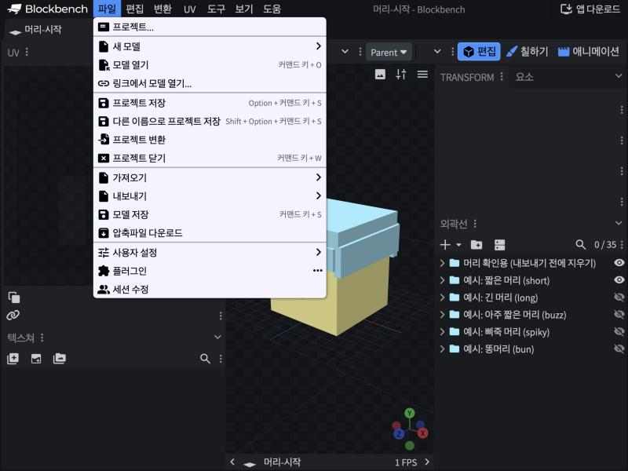
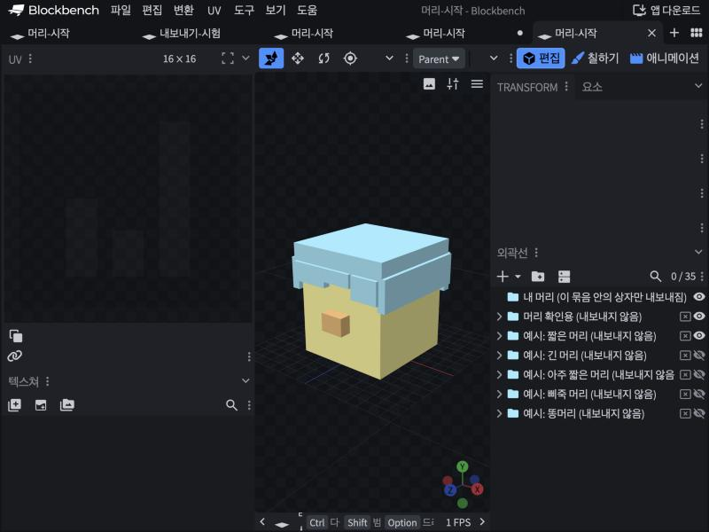
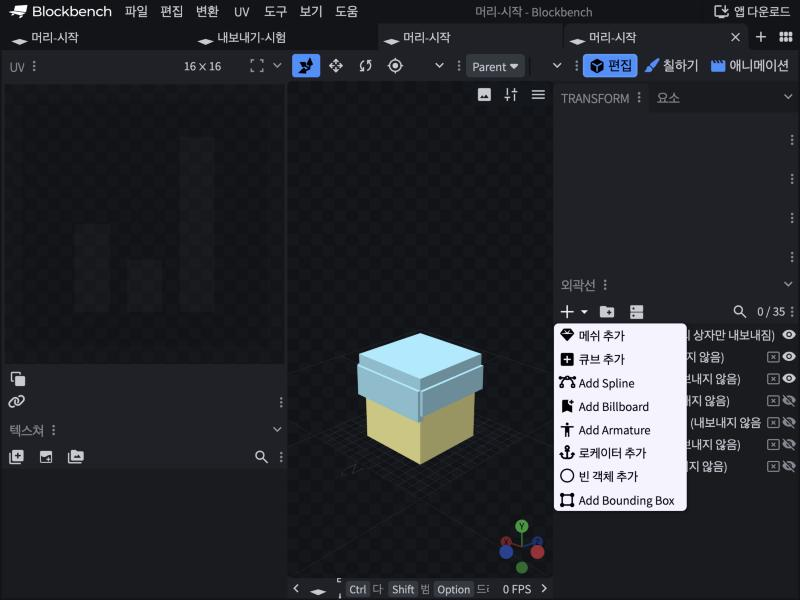
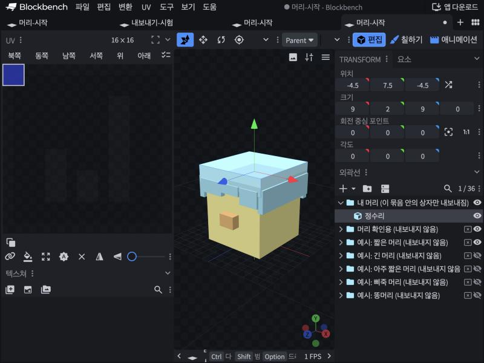
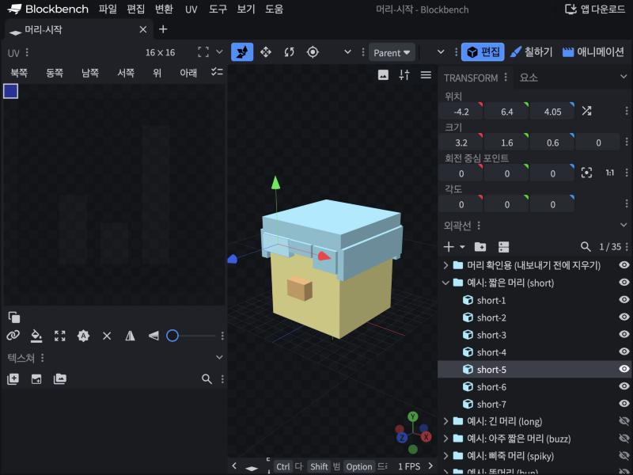
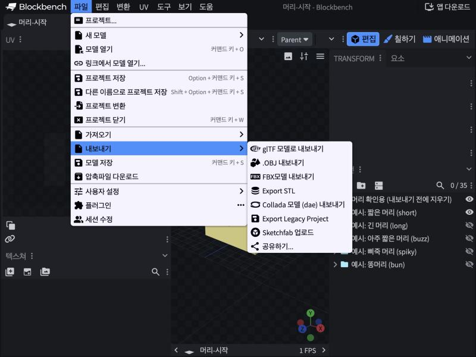
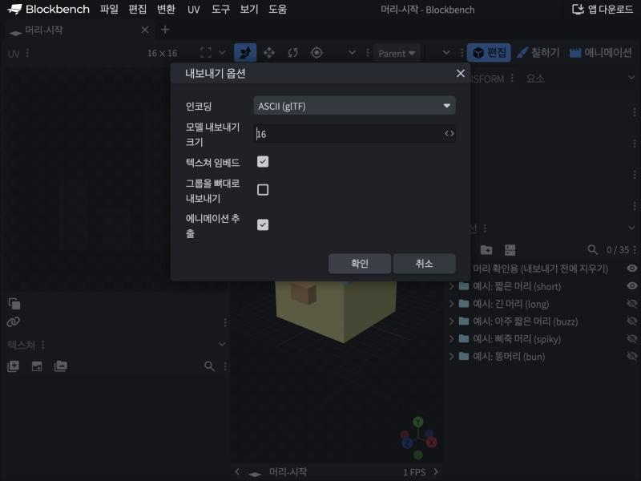

# Blockbench 로 머리카락 만들기 (#296)

캐릭터의 머리카락은 머리에 붙이는 **네모 상자들**이다. [Blockbench](https://www.blockbench.net)(무료)로 상자를 쌓아 모양을 만들고, 파일 하나로 내보내면 앱에 넣을 수 있다.
칠하지 않아도 된다. 앱이 사용자가 고른 머리 색을 입히고, 윗면은 밝게·옆면은 어둡게 칠해 준다.

## 0. 준비

- Mac 앱(https://www.blockbench.net 에서 받기)이나, 설치 없이 브라우저에서 https://web.blockbench.net 을 연다.
- 마우스가 있으면 훨씬 편하다.
- 화면이 영어면 파일(File) → 사용자 설정(Settings) → 언어(Language)에서 한국어로 바꾼다.

## 1. 시작 파일 열기

**파일 → 모델 열기** 에서 `art/hair/머리-시작.bbmodel` 을 고른다(파일을 Blockbench 창에 끌어다 놓아도 된다).



열면 이렇게 보인다.



- **가운데 3D 화면**
  - 노란 상자 = 캐릭터 머리
  - 주황 작은 상자 = 얼굴 쪽(코)
  - 파란 상자 = 예시 머리(짧은 머리)
- **오른쪽 아래 "외곽선"** = 상자 목록. 폴더 모양이 묶음이다.
  - **`내 머리` 묶음 안의 상자만 내보내진다.** 여기에 만든다.
  - 나머지 묶음(머리 확인용, 예시 5개)은 이름 끝에 "(내보내지 않음)"이 있고 옆에 ⊠ 표시가 있다. 그대로 둬도 내보낼 때 빠진다.
  - 눈 아이콘 = 화면에 보이기/숨기기. 예시 머리를 하나씩 켜서 볼 수 있다.

**화면 돌려 보기** (마우스)
- 왼쪽 버튼으로 끌기 = 돌리기
- 오른쪽 버튼으로 끌기 = 옮기기
- 휠 = 확대·축소

## 2. 상자 만들기

1. 외곽선에서 **`내 머리` 묶음을 누른다**(고른 묶음 안에 새 상자가 생긴다).
2. 외곽선 위의 **+ → 큐브 추가** 를 누른다.



3. 새 상자를 고른 채로 오른쪽 위 **TRANSFORM** 칸에 숫자를 넣는다.
   - **위치** = 상자의 한쪽 모서리(가로 X, 높이 Y, 앞뒤 Z)
   - **크기** = 가로·높이·깊이
   - **각도** = 기울이기



> 위 그림은 `내 머리` 에 "정수리" 상자를 하나 만든 모습. 위치 (-4.5, 7.5, -4.5), 크기 (9, 2, 9) → 머리 위를 덮는 판.

**숫자 감 잡기** (머리 한 칸 = 1)

| 머리 | 범위 |
|---|---|
| 가로 X | -4 ~ 4 (오른쪽이 +) |
| 높이 Y | 0(턱) ~ 8(정수리) |
| 앞뒤 Z | -4(뒤통수) ~ 4(얼굴) |

- 머리카락은 머리보다 **조금 크게**(0.2~0.5 정도 바깥으로) 만들어야 머리가 비쳐 보이지 않는다.
- **앞머리**는 얼굴보다 앞(Z가 4.05 이상)에 둔다. 아래 끝은 **높이 5.5 위**로 둬야 눈썹·눈을 가리지 않는다.
- 소수(0.5 같은 것)도 된다. 상자를 기울여도 된다.

## 3. 상자 다루기



| 하고 싶은 것 | 방법 |
|---|---|
| 고르기 | 3D 화면에서 상자 클릭, 또는 외곽선에서 이름 클릭 |
| 옮기기 | 고른 상자에 나오는 화살표를 끌기(이동 도구, 단축키 V), 또는 위치 숫자 고치기 |
| 크기 바꾸기 | 크기 조절 도구(단축키 S)로 끌기, 또는 크기 숫자 고치기 |
| 복사 | ⌘(Ctrl) + D |
| 지우기 | Delete(⌫) |
| 되돌리기 | ⌘(Ctrl) + Z |
| 이름 바꾸기 | 외곽선에서 이름을 두 번 클릭 |
| 묶음 옮기기 | 외곽선에서 상자를 끌어 다른 묶음 위에 놓기 |

**예시를 고쳐서 쓰고 싶으면:** 예시 묶음을 펼쳐 상자들을 끌어다 `내 머리` 묶음 위에 놓은 뒤 고친다.

## 4. (선택) 무늬 칠하기

칠하지 않아도 된다. 무늬를 넣고 싶을 때만 칠한다.

1. 왼쪽 아래 **텍스쳐** 칸의 **+** 로 그림을 만든다.
2. 위쪽 **칠하기** 탭에서 상자에 칠한다.
3. 머리카락은 **흰색·회색**으로 칠한다. 앱에서 고른 머리 색이 곱해지므로 진한 회색일수록 어둡게 나온다.
4. 색을 그대로 두고 싶은 부분(예: 빨간 머리핀)은 그림을 하나 더 만들어 이름에 `fixed` 를 넣고 그 그림으로 칠한다.

## 5. 저장하고 내보내기

파일 이름은 영어 id 하나로 맞춘다(영문 소문자·숫자·`-`, 예: `bob`, `twin-tails`). 앱의 주소와 목록에 이 이름이 그대로 들어간다.

| 파일 | 저장할 곳 | 뜻 |
|---|---|---|
| `id.bbmodel` | `art/hair/` | 고치는 원본. 앱은 쓰지 않는다 |
| `id.gltf` | `public/models/Parts/hair/` | 앱이 불러오는 파일 |

1. **저장:** 나중에 고칠 수 있게 **파일 → 프로젝트 저장** 으로 `art/hair/id.bbmodel` 에 저장한다. 웹에서는 다운로드 폴더에 저장되니 옮겨 둔다.
   - 시작 파일(`머리-시작.bbmodel`)에서 시작했으면 ⌘S 를 누르지 말고 **다른 이름으로 저장** 한다. ⌘S 는 시작 파일을 덮어쓴다.
2. **내보내기:** **파일 → 내보내기 → glTF 모델로 내보내기**



3. 옵션은 **그대로 두고 확인**. "모델 내보내기 크기 16"은 바꾸지 않는다(앱이 이 크기에 맞춰 키운다).



4. 내보낸 `.gltf` 를 **`public/models/Parts/hair/id.gltf`** 로 저장한다. 같은 이름이 있으면 대치(덮어쓰기)한다.
   - 이미 앱에 있는 머리를 고친 거면 여기서 끝이다. 화면을 새로 고치면 바뀐 머리가 보인다.
   - 새 머리면 `src/avatar/parts.json` 의 `hair` 목록에 한 줄을 더한다. 보이는 이름(예: "양갈래 머리")을 알려 주면 넣어 준다.
     ```json
     { "id": "twin-tails", "name": "양갈래 머리", "model": "/models/Parts/hair/twin-tails.gltf" }
     ```

## 자주 하는 실수

- `내 머리` 묶음 밖에 상자를 만들면 내보내지지 않는다. 외곽선에서 상자가 `내 머리` 아래에 들어가 있는지 본다.
- 앞머리가 얼굴 안쪽(Z가 4보다 작음)에 있으면 얼굴에 묻혀 안 보인다.
- 머리와 똑같은 크기로 만들면 머리 색과 피부가 겹쳐 지글거린다. 조금 크게 만든다.
