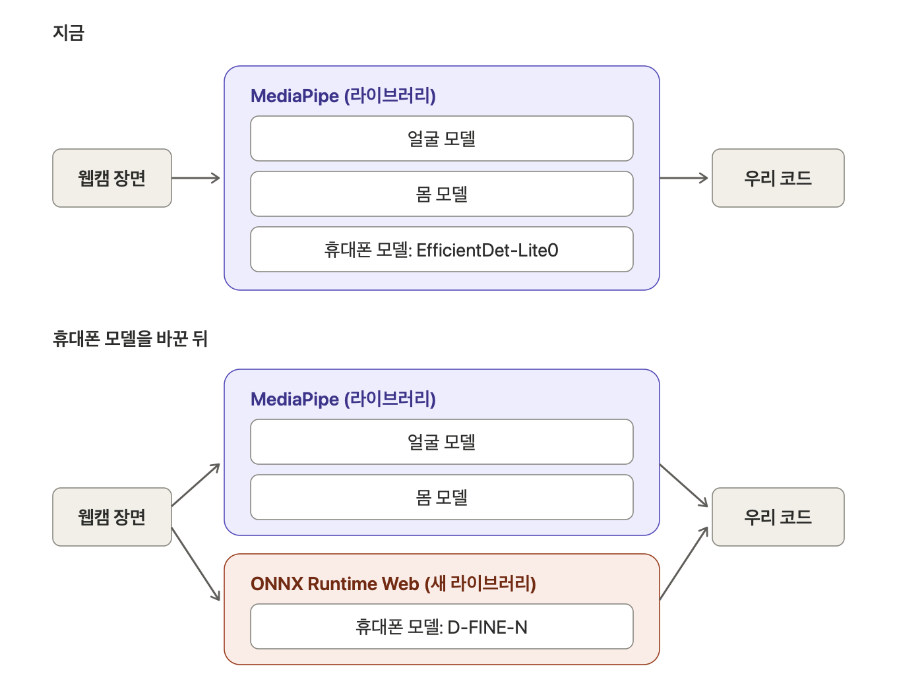

# 휴대폰 감지 모델 비교표 (팀 논의용, 2026-11-16)

## 1. 조건

| 순위 | 조건 | 뜻 |
|---|---|---|
| 필수 | 유료 서비스로 바꿀 수 있어야 한다 | 넣으면 코드 전체를 공개해야 하는 라이선스(AGPL·GPL)나 비상업 전용은 안 된다 |
| 필수 | 손을 귀 옆에 댄 자세는 초록불 | 받아 온 모델은 모두 이 자세를 휴대폰으로 잡는다. 그렇게 학습돼 있기 때문이다. 그래서 **우리 영상으로 다시 학습시킬 수 있는 모델**이어야 한다 |
| 1 | 정확도 | 휴대폰을 잘 찾고, 휴대폰이 아닌 것을 휴대폰으로 잡지 않는다 |
| 2 | 무게 | 지금도 렉과 발열이 있어 자원을 덜 쓰는 쪽이 좋다 |
| 방향 | 우리 영상으로 더 학습시킨다 | 팀원 셋이 여러 장소에서 찍는다. 수백 장 정도 |
| 덜 중요 | 속도 | 휴대폰을 든 뒤 5초 안에만 잡히면 된다. 2초에 한 번 돌려도 된다 |
| 덜 중요 | 태블릿 감지 | 되면 좋지만 없어도 된다 |
| 보류 | 상자 크기 규칙 | 휴대폰 크기와 거리에 따라 진짜 휴대폰이 빠질 수 있어 쓰지 않는다 |

## 2. 트래킹이 돌아가는 구조 (라이브러리와 모델)

### 낱말

| 낱말 | 뜻 | 우리 서비스에서는 |
|---|---|---|
| **라이브러리** | 모델 파일을 읽어서 실제 계산을 돌리는 프로그램 | MediaPipe (1개) |
| **모델** | 학습으로 얻은 숫자가 든 파일. 혼자서는 아무것도 못 한다 | 얼굴 모델, 몸 모델, 휴대폰 모델 (3개) |
| **우리 코드** | 라이브러리가 낸 숫자를 받아 판정하고 캐릭터에 입히는 부분 | `useTracking.ts`, `focusLogic.ts` 등 |

모델 세 개의 정식 이름: 얼굴 모델 = Face Landmarker, 몸 모델 = Pose Landmarker lite, 휴대폰 모델 = EfficientDet-Lite0.
"MediaPipe로 휴대폰을 잡는다"와 "EfficientDet-Lite0으로 휴대폰을 잡는다"는 같은 일을 라이브러리 쪽과 모델 쪽에서 부른 말이다.

### 지금의 순서

| 단계 | 언제 | 누가 | 무엇을 |
|---|---|---|---|
| 1 | 자리에 앉을 때 | 브라우저 | 웹캠을 켠다 (640×480) |
| 2 | 바로 이어서 | 브라우저 | 라이브러리(MediaPipe)를 내려받아 켠다 |
| 3 | 바로 이어서 | 라이브러리 | 얼굴 모델과 몸 모델 파일을 내려받아 읽는다 |
| 4 | 공부를 시작할 때 | 라이브러리 | 휴대폰 모델 파일을 내려받아 읽는다 ("휴대폰·학습기기 사용함"이면 건너뜀) |
| 5 | 새 장면마다 | 라이브러리 + 얼굴 모델 | 고개 각도, 눈 뜬 정도, 얼굴이 보이는지를 숫자로 낸다 |
| 6 | 1초에 15번 | 라이브러리 + 몸 모델 | 팔 방향, 몸이 화면 안에 있는지를 낸다 |
| 7 | 1초에 1번 | 라이브러리 + 휴대폰 모델 | 휴대폰이 "있다/없다"를 낸다 |
| 8 | 0.1초마다 | 우리 코드 | 5~7의 숫자로 초록·노랑·빨강을 정하고 타이머를 올리거나 멈춘다 |
| 9 | 계속 | 우리 코드 | 고개·눈·팔 숫자를 내 캐릭터에 입힌다 |
| 10 | 계속 | 우리 코드 | 숫자만 서버로 보내 다른 사람 화면에 반영한다. 영상은 나가지 않는다 |

5~7단계에서 라이브러리는 매번 네 가지를 한다: 장면 가져오기 → 모델이 받는 크기로 줄이기 → 모델의 숫자로 계산하기 → 결과 정리해서 우리 코드에 넘기기.

### 휴대폰 모델을 바꾸면



(노션에 붙일 때는 `docs/휴대폰-모델-구조.png`를 따로 끌어다 넣는다. 아래는 같은 내용의 글자 그림이다.)

```
[지금]
웹캠 장면 ──→ MediaPipe (라이브러리) ──────────────→ 우리 코드
              ├ 얼굴 모델
              ├ 몸 모델
              └ 휴대폰 모델: EfficientDet-Lite0

[휴대폰 모델을 바꾼 뒤]
웹캠 장면 ─┬→ MediaPipe (라이브러리) ─────────────┬→ 우리 코드
           │   ├ 얼굴 모델                         │
           │   └ 몸 모델                           │
           └→ ONNX Runtime Web (새 라이브러리) ────┘
               └ 휴대폰 모델: D-FINE-N 또는 PP-PicoDet-M
```

- 새 휴대폰 모델(D-FINE-N, PP-PicoDet-M)은 MediaPipe가 읽지 못하는 모양이다. 그래서 그 모델을 돌릴 라이브러리(ONNX Runtime Web)를 MediaPipe 옆에 하나 더 놓는다.
- 바뀌는 단계는 2번(라이브러리를 2개 켬), 4번과 7번(휴대폰 모델을 새 라이브러리가 돌림)뿐이다. 얼굴·몸과 우리 코드의 판정은 그대로다.

## 3. 끝까지 남은 후보

| | 지금 모델 (EfficientDet-Lite0) | PP-PicoDet-M | D-FINE-N |
|---|---|---|---|
| 나온 때 | 2019~2021 | 2021~2022 | 2024~2025 |
| 유료 서비스 | 가능 | 가능 (Apache-2.0) | 가능 (Apache-2.0) |
| **귀 옆 손을 초록불로 만들 수 있나** (다시 학습시킬 수 있나) | **어려움.** 학습 도구가 2022년에 멈춰 설치가 안 됨 | **가능.** 맥북에서 실제로 이어서 학습시켰고, 작은 시험에서 귀 옆 손 오판이 34장에서 0장으로 줄었다(아래 "학습 시험") | **가능.** 공식 안내문에 자기 영상으로 학습하는 방법이 있음. 무료 Colab에서 도는지는 확인 못 함 |
| 실행 라이브러리 추가 | 없음 | 하나 추가 | 하나 추가 |
| 80종 평균 점수 (공개값) | 26.4 | 34.4 | 42.8 |
| 보는 사진 크기 | 320 | 320 | 640 |
| 보이게 든 휴대폰을 잡은 비율 | 71% | **95%** | 66% |
| 편하게 쓰는 휴대폰을 잡은 비율 | 51% | **88%** | 79% |
| 평소 공부 때 잘못 잡은 횟수 (100번 중) | 0번 | 0번 | 0번 |
| (참고) 받아 온 그대로일 때 귀 옆 손을 휴대폰으로 잡은 횟수 (100번 중) | 20번 | 37번 | 25번 |
| 한 번 도는 시간 | 26~28ms | 77ms (CPU) | 172~180ms (CPU), 69ms (그래픽 장치) |
| 모델 파일 크기 | 7.3MB | 13.9MB | 15.3MB |
| 태블릿 | 못 잡음 | 못 잡음 (우리가 찍어 학습시키면 가능) | 못 잡음 (우리가 찍어 학습시키면 가능) |

- 잡은 비율과 시간은 2026-11-16에 김현 1명이 찍은 4분 영상으로 잰 값이다(장면마다 100번, 기준 점수 0.3). 한 사람, 한 자리, 한 번이다.
- PP-PicoDet-M은 같은 영상을 다시 넣어 쟀다. 그때 다른 모델들의 값은 첫 측정과 똑같이 나왔다.
- 80종 평균 점수는 각 모델이 공개한 값이고, 휴대폰만의 점수가 아니다. 우리 영상에서는 공개 점수 순서와 다르게 나왔다.
- **귀 옆 손 오판은 받아 온 모델이면 어느 것이든 난다.** 모두 같은 종류의 사진으로 배웠기 때문이다. 그래서 받아 온 상태의 오판 횟수는 모델을 고르는 기준이 아니다. 기준은 **"귀 옆 맨손은 휴대폰이 아니다"를 우리 영상으로 다시 가르칠 수 있느냐**다.
- 다시 가르치는 방법: 귀 옆 손·턱 괴기 영상을 "휴대폰 없음"으로 넣어 학습시킨다. 흔히 쓰는 방법이다. 얼마나 줄어드는지는 학습시켜 봐야 안다.
- PP-PicoDet-M은 귀 옆 손을 더 자주, 더 높은 점수로 휴대폰이라고 한다(기준 점수 0.5에서도 14번. 다른 두 모델은 1번). 학습으로 고쳐야 할 양이 더 많다는 뜻이다.

### 학습 시험 (2026-11-16)

PP-PicoDet-M을 우리 영상으로 이어서 학습시켜, 귀 옆 손 오판이 줄어드는지 봤다.

- 학습에 쓴 것: 4분 영상의 장면마다 뒤 절반에서 뽑은 그림 319장. 휴대폰이 있는 그림 131장(받아 온 모델이 0.5점 이상으로 잡은 상자를 정답으로 씀), 귀 옆 손·평소 공부 그림 188장(상자 없이 넣어 "휴대폰 없음"으로 배우게 함).
- 채점에 쓴 것: 장면마다 앞 절반에서 뽑은 그림 50장씩. 학습에 쓰지 않았다. 귀 옆 손 오판이 앞 절반에 몰려 있어서, 오판이 적은 쪽으로 배우고 많은 쪽으로 채점한 것이다.
- 도구: PaddleDetection v2.9.0, PaddlePaddle 3.3.1. 영상은 외부로 보내지 않고 맥북에서 학습했다.

| 채점용 그림 (장면마다 50장) | 학습 전 | 학습 후 |
|---|---|---|
| 보이게 든 휴대폰을 잡음 | 46장 | **50장** |
| 편하게 쓰는 휴대폰을 잡음 | 44장 | **47장** |
| 귀 옆 손을 휴대폰으로 잘못 잡음 | 34장 | **0장** |
| 평소 공부 때 잘못 잡음 | 0장 | 0장 |

- 귀 옆 손 그림에서 나온 휴대폰 점수의 최고값이 0.70에서 0.18로 내려갔다(기준 점수는 0.3).
- 학습은 맥북(M4, CPU)에서 50분 걸렸다. 그림 319장, 30바퀴.
- **한계가 크다.** 같은 사람, 같은 자리, 같은 휴대폰, 같은 날 찍은 영상의 앞 절반과 뒤 절반이다. 다른 사람·다른 자리·다른 휴대폰에서도 통하는지는 모른다. "방법이 통한다"는 확인이지 "완성됐다"는 뜻이 아니다.
- 학습한 모델을 브라우저용 파일(ONNX, 14MB)로 바꿔 비교 화면에서 같은 영상으로 다시 쟀다. 파이썬에서 잰 것과 같은 결과가 나왔다(학습에 쓰지 않은 앞 절반, 장면마다 40번).

| 브라우저에서 잰 값 | 지금 모델 | PP-PicoDet-M (받아 온 그대로) | PP-PicoDet-M (우리 영상 학습) |
|---|---|---|---|
| 보이게 든 휴대폰을 잡음 | 53% | 95% | **100%** |
| 편하게 쓰는 휴대폰을 잡음 | 53% | 88% | **93%** |
| 귀 옆 손을 휴대폰으로 잘못 잡음 | 11번 | 24번 | **0번** |
| 평소 공부 때 잘못 잡음 | 0번 | 0번 | 0번 |
| 한 번 도는 시간 | 약 27ms | 약 76ms | 약 72ms |

## 4. 라이브러리를 하나 더 넣으면 생기는 일

| 항목 | 내용 | 확인 정도 |
|---|---|---|
| 내려받는 양 | 새 라이브러리의 실행 파일 약 15MB(CPU용)와 새 모델 파일 14~15MB를 더 받는다. 지금 휴대폰 모델은 7.3MB다. 한 번 받으면 브라우저가 저장해 둔다 | 파일 크기 확인 |
| 메모리 | 라이브러리 두 개가 동시에 떠 있다 | 얼마나 느는지 안 잼 |
| 한 번 도는 시간 | 26ms → 77ms(PP-PicoDet-M) 또는 172~180ms(D-FINE-N). 2초에 한 번만 돌리면 1초당 부담은 절반이다 | 비교 화면에서 잼 |
| 그래픽 장치 다툼 | CPU에서 돌리면 3D 화면과 다투지 않는다. 그래픽 장치(WebGPU)로 돌리면 빨라지지만 3D 화면과 다툴 수 있다 | 서비스 화면에서는 안 잼 |
| 우리 코드가 떠맡는 일 | MediaPipe가 해 주던 "장면을 모델 크기로 줄이기"와 "결과에서 휴대폰 점수·상자 읽기"를 직접 한다. 비교 화면에 이미 짜 두었다 | 비교 화면에서 동작 확인 |
| 관리 | 라이브러리 두 개의 버전을 따로 챙긴다. 휴대폰 쪽이 고장 나도 얼굴·몸은 계속 돌게 지금처럼 따로 둔다 | — |
| 라이선스 | ONNX Runtime Web은 MIT라 유료 서비스에 쓸 수 있다 | 확인 |
| 팀 규칙 | 목록에 없는 라이브러리라 팀 확인이 필요하다 | — |
| 아직 모르는 것 | 3D 화면, 얼굴, 몸과 같이 돌 때 렉과 발열이 얼마나 느는지 | 안 잼 |

## 5. 일찍 뺀 것

| 모델 | 뺀 이유 |
|---|---|
| YOLO 계열 전부 (YOLO26n, YOLO11n, YOLOv8n 등) | AGPL-3.0. 넣으면 서비스 전체 코드를 같은 조건으로 공개해야 한다. 태블릿을 아는 판도 여기에만 있다 |
| YOLO-World, YOLOE | GPL-3.0·AGPL-3.0 |
| DEIMv2 | 2026년에 비상업 전용 라이선스로 바뀜 |
| YOLO-NAS | 학습된 파일을 다시 배포할 수 없음 |
| EfficientDet-Lite0 가벼운 판 (int8·CPU) | 재 보니 더 못 잡고(보이게 들기 23%) 더 느림(42ms) |
| EfficientDet-Lite2 | 원준 측정에서 Lite0과 비슷하게 잡는데(95% 대 96%) 더 무거움 |
| RF-DETR Nano, RT-DETR | 파일이 60~108MB라 브라우저에 무거움 |
| YOLOX-Nano | 점수가 지금 모델보다 낮음(25.8) |
| MediaPipe 전용 학습 도구로 만든 모델 | 도구가 2024년 4월에 멈췄고 공식 예제가 2026-11-10에 삭제됨 |
| NanoDet-Plus, RTMDet-tiny | 유료 서비스는 가능하지만 학습 절차를 확인하지 못했고 재 보지 않음 |

## 6. 지금 생각하는 방향

**휴대폰 모델만 새 라이브러리로 옮기고, 우리 영상으로 더 학습시켜 쓴다.** 학습한 모델이 지금 모델을 이길 때까지 서비스는 지금 모델을 그대로 둔다.

학습시킬 후보는 둘이다.

| | PP-PicoDet-M | D-FINE-N |
|---|---|---|
| 받아 온 상태에서 잡는 비율 | 더 높음 (95%, 88%) | 66%, 79% |
| 무게 | 더 가벼움 (77ms) | 172~180ms |
| 학습 도구 | 맥북에서 실제로 돌았음(2026-11-16). 귀 옆 손 오판이 줄어드는 것까지 확인 | 안내문이 최신. 돌려 보지 않음 |
| 귀 옆 손 (받아 온 상태) | 더 많이 틀림 (37번) | 25번 |

- 조건(정확도, 무게)만 보면 PP-PicoDet-M이 앞선다. 처음에는 공개 점수가 가장 높은 D-FINE-N을 골랐는데, 우리 영상으로 재 보니 순서가 달랐다.
- PP-PicoDet-M은 학습이 실제로 돌았고 귀 옆 손 오판도 줄었다. 그래서 **PP-PicoDet-M으로 간다.** D-FINE-N은 PP-PicoDet-M이 여러 사람 영상에서 통하지 않을 때의 대안으로 남긴다.

## 7. 팀과 정할 것

1. **실행 라이브러리를 하나 추가해도 되는지.** 두 후보 모두 MediaPipe에 꽂히지 않아 ONNX Runtime Web(MIT)이 필요하다. 얼굴·몸 인식은 MediaPipe 그대로 쓴다. (4절)
2. **무게를 받아들일 수 있는지.** 한 번 도는 시간이 26ms에서 77ms 또는 172~180ms로 늘어난다. 서비스에 넣었을 때 렉과 발열이 얼마나 느는지는 아직 재지 않았다.
3. **영상을 누가 언제 찍는지.** 셋이 각자 자리에서 휴대폰 사용, 귀 옆 손·턱 괴기, 평소 공부를 찍는다. 휴대폰 크기와 거리를 여러 가지로 한다.
4. **아직 모르는 것.** 한 사람의 영상으로 한 시험이라, 다른 사람·다른 자리·다른 휴대폰에서도 통하는지는 셋이 찍은 영상으로 다시 해 봐야 안다. 서비스 화면(3D, 얼굴, 몸)과 같이 돌 때의 렉과 발열도 아직 재지 않았다.
